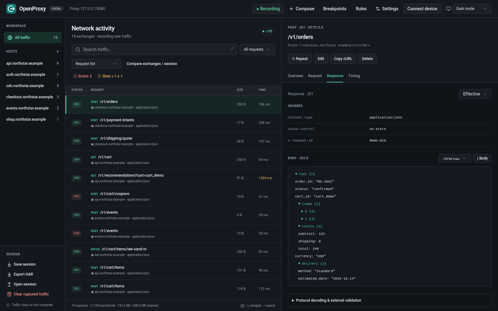

<p align="center">
  
</p>

<h1 align="center">OpenProxy</h1>

<p align="center">
  <strong>Examine your app's HTTP and HTTPS traffic.</strong><br>
  Examine, edit, and replay requests in a local browser inspector.
</p>

<p align="center">
  Linux · Rust · <a href="LICENSE">MIT license</a>
</p>

<p align="center">
  <a href="#quick-start">Quick start</a> ·
  <a href="#inside-the-inspector">The inspector</a> ·
  <a href="#rules-and-breakpoints">Rules</a> ·
  <a href="#mobile-devices">Mobile setup</a> ·
  <a href="#configuration-and-stored-data">Configuration</a> ·
  <a href="#troubleshooting">Troubleshooting</a> ·
  <a href="#development-and-verification">Development</a>
</p>

<picture>
  <source media="(prefers-color-scheme: light)" srcset="docs/images/inspector-light.png">
  
</picture>

OpenProxy combines a Rust proxy and a web inspector in one binary. It runs locally without an account, Node service, or external UI assets.

Connect your app, browser, or mobile device to the proxy. For HTTPS inspection, install and trust its certificate authority (CA).

## Quick start

Use **Linux**, **Rust 1.89+**, **Node 22.12+**, a C toolchain, and a linker. Node 24 is recommended. Node is necessary only for the inspector build. The proxy runs on Linux. Other platforms can connect as clients.

### 1. Build and run

Run these commands from the repository root:

```sh
npm --prefix web ci
npm --prefix web run build
cargo build --release --locked
./target/release/openproxy
```

### 2. Open your workspace

Open the **Inspector** URL from the terminal, with its `/#TOKEN` fragment. The token authenticates the browser to the local API. The inspector removes the fragment and saves the token for that tab.

Each restart creates a new token. After a restart, open the new URL or enter its token in the connection dialog.

| Listener          | Default address  |
| ----------------- | ---------------- |
| HTTP/HTTPS proxy  | `127.0.0.1:8080` |
| Browser inspector | `127.0.0.1:8081` |

### 3. Capture a request

Run these commands in another terminal:

```sh
curl --noproxy "" --proxy http://127.0.0.1:8080 http://example.com/
curl --noproxy "" --proxy http://127.0.0.1:8080 --cacert data/ca.pem https://example.com/
```

Both requests appear in the traffic list. For other clients, set the HTTP proxy to **`127.0.0.1:8080`**. For HTTPS inspection, trust **`data/ca.pem`**.

Stop with `Ctrl+C` to save the retained session. The proxy continues to run after you close the inspector tab. Before you stop the proxy, restore desktop and device proxy settings.

<details>
<summary>Install the binary on your PATH</summary>

After the web build, run:

```sh
cargo install --path . --locked
openproxy --help
```

</details>

## Inside the inspector

The inspector shows hosts on the left, requests in the center, and details on the right. Each pane scrolls independently. Select light, dark, or system theme.

| Task                          | Tools                                                                                                                 |
| ----------------------------- | --------------------------------------------------------------------------------------------------------------------- |
| **Find failed requests**      | Host and text search, error and slow-request filters, host/path tree, waterfall, session statistics.                  |
| **Examine bodies**            | Headers, cookies, query parameters, JSON trees, text, hex, images, compressed bodies, request/connection/TLS timings. |
| **Send requests**             | Composer, edit and replay, repeat count, concurrency, cURL commands, body downloads.                                  |
| **Change responses**          | Ordered rules for headers, URLs, query parameters, body edits, mocks, blocks, local/remote mapping.                   |
| **Pause exchanges**           | Request/response breakpoints with inspection, edits, resume, and abort controls.                                      |
| **Simulate network problems** | Latency, individual/shared bandwidth limits, offline mode, failures, drops at specified byte counts.                  |
| **Save captures**             | Saved sessions, HAR import/export, notes, marks, original/effective snapshots, exchange/session comparison.           |

HTTP/1.1 and HTTP/2 inspection use verified upstream TLS. Protocol tools examine WebSocket frames, XML, Protobuf, gRPC, and AMF. OpenProxy also has SOCKS5, PAC files, reverse proxies, TCP forwarding, upstream proxies, and client certificates.

**Keyboard shortcuts:** `Ctrl/⌘K` or `/` selects search. In the selected request list, `↑`/`↓` and `Home`/`End` move the selection. On narrow screens, **Session & hosts** opens the sidebar controls.

### Find and examine traffic

Select a host or **All traffic**. Search by URL, method, client address, status, or content type. Search ignores letter case. It does not search bodies.

**Errors** includes HTTP 4xx/5xx and failed exchanges. **Slow** includes completed requests that take at least one second. The dropdown also filters HTTPS, JSON, active, and marked exchanges. For other traffic views, select **Host/path tree** or **Waterfall & statistics**.

Select an exchange to see these tabs:

| Tab                    | Contents                                                                                                                               |
| ---------------------- | -------------------------------------------------------------------------------------------------------------------------------------- |
| **Overview**           | URL, query parameters, cookies, upstream destination, connection reuse, DNS/TCP/TLS details, rule actions, notes, marks.               |
| **Request / Response** | Headers, trailers, bodies. **Effective** shows the forwarded message. **Original** shows the captured message before edits.            |
| **Timing**             | Time until headers, body transfer time, total time. Header time includes upload, proxy delay, connection setup, and origin processing. |

Select **Pretty**, **Text**, **JSON tree**, **Hex**, or **Image** above a body. Pretty view formats JSON, XML, and form data. Previews decode available compression formats. **↓ Body** downloads captured bytes with their compression and any truncation. The inspector shows captured HTML as text. It does not execute HTML.

Use **Save note & mark** to save notes and mark an exchange. Marks help you find exchanges later.

Expand **Protocol decoding & external validation** in a request or response tab for local Protobuf, gRPC envelope, or AMF decoding. Protobuf without a schema shows field numbers and wire types. For field names, load a binary `FileDescriptorSet` of at most 1 MiB. Enter the fully qualified message name. To create a descriptor from your `.proto` files, run:

```sh
protoc --include_imports --descriptor_set_out=messages.pb service.proto
```

**Overview** shows WebSocket frames with direction, opcode, fragments, and captured payloads. Payload and frame limits apply only to inspection. Compressed frames show compressed bytes. External HTML/CSS/feed validation uses explicit consent for each submission. See [Limits and privacy](#limits-and-privacy).

### Compose, edit, and repeat

**Compose** sends a new request. Enter an absolute HTTP(S) URL, method, and headers, with one header on each line. Add an optional UTF-8 or Base64 body. **Edit** opens the selected exchange's forwarded request. After your edits, click **Send request →**. The result appears in the traffic list.

- New requests apply rules by default. **Edit** disables rules to prevent duplicate edits. Global network and settings controls still apply with rules disabled.
- **Edit** shows and keeps captured request trailers. If you change the body, update trailer checksum fields. **Repeat** also keeps request trailers.
- **Repeat** sends one copy. If an original request snapshot exists, it uses that snapshot with current rules. Otherwise, it uses the forwarded request with rules disabled.
- Set the composer's repeat count to **1–1,000** and concurrency to **1–32**. Bodies have a **1 MiB** limit. **CAUTION:** Repeated requests can create orders, charge payments, or change server data.
- Truncated requests, incomplete requests, and opaque tunnels cannot use **Repeat**, **Edit**, or **Copy cURL**. **Copy cURL** uses the forwarded request. The command uses your shell/client proxy settings unless you add proxy options. It can contain credentials or cookies.
- **Copy cURL** rejects requests with trailers because its command cannot keep them. For these requests, use **Repeat** or **Edit**.

### Save and compare sessions

Use **Save session**, **Export HAR**, **Open session**, and **Clear** in the sidebar. Native JSON sessions keep OpenProxy capture metadata. HAR exchanges traffic with other tools, which can ignore OpenProxy extensions. Imports accept both formats within current capture and retention limits. Imports load traffic without proxy settings, certificates, or mirror files.

**Open session** replaces current traffic. **Clear** and an exchange's **Delete** remove retained traffic. Before removal, save the necessary captures. With **Recording** paused, forwarding and rules continue without new retained exchanges.

Select **Compare exchanges / session** to compare two exchanges or a saved native/HAR file. File comparison keeps the current session. Session comparison pairs exchanges with the same method and URL in capture order. Incomplete bodies give an **unknown** result.

## Rules and breakpoints

Open **Rules**. Use the visual editor or JSON view. Add an example. Set its URL pattern and optional method. Arrange its actions. Click **Save rules**.

URL patterns are case-sensitive globs. `*` matches any sequence. `?` matches one character. Rules match the original URL and method. URL edits do not change which rules match.

All enabled rules that match participate. Within each phase, actions run in list order across rules. Later header, status, and body changes can replace earlier changes. Simulation actions run before request actions. Response actions run after a response is available.

**Block** returns HTTP 403. **Offline** returns HTTP 503. Both stop subsequent request actions. Response rules can change mock and local responses.

<details>
<summary>Example: return a mock JSON response</summary>

Paste this array into the JSON editor. Replace the URL with your endpoint:

```json
[
  {
    "name": "Catalog under maintenance",
    "enabled": true,
    "url": "https://api.example.com/catalog*",
    "method": "GET",
    "actions": [
      {
        "type": "mock",
        "status": 503,
        "headers": [["Content-Type", "application/json"]],
        "body": "{\"error\":\"Temporarily unavailable\",\"retry_after\":30}"
      }
    ]
  }
]
```

The rule returns a local response without a request to the origin. After use, disable the rule.

</details>

Rules can add or remove headers and query parameters, edit URLs or bodies, and change response status. They can also map destinations, simulate networks, mirror bodies, and pause exchanges. The proxy controls transport framing (`Host`, `Content-Length`, hop-by-hop headers). Header rules cannot change it.

Text body edits use UTF-8. For gzip and deflate, OpenProxy decodes, edits, and re-encodes the body. A matching edit fails the exchange if decoding fails or the encoded/decoded buffer exceeds **1 MiB**. Ordinary traffic streams without this edit buffer.

| Action         | Behavior                                                                                                                                                                                                                                                                                                                                                                                                                         |
| -------------- | -------------------------------------------------------------------------------------------------------------------------------------------------------------------------------------------------------------------------------------------------------------------------------------------------------------------------------------------------------------------------------------------------------------------------------- |
| **Map remote** | Replaces the literal URL prefix `from` with `to`. Preserves the remaining path/query text. Destinations must be absolute HTTP(S) URLs.                                                                                                                                                                                                                                                                                           |
| **Map local**  | Serves a file or a URL path in a directory after removal of `url_prefix`. With prefix `/assets/`, a directory mapping serves its `logo.png` for `/assets/logo.png`. Relative paths start from OpenProxy's working directory. Missing files use the next action or origin. Directory mappings reject traversal and symlinks with targets not in the directory.                                                                    |
| **Mirror**     | Writes request/response body streams to private files in `directory`. The last matching action sets `directory` and `max_bytes`. The limit applies to each body, with no total directory limit. Completed files end in `.bin`, while interrupted or limited files end in `.bin.partial`. Overview shows paths, completion, and errors. Mirrors use recording, remain external to session exports, and have no automatic cleanup. |

### Pause an exchange

In Rules, add a **Pause a request** or **Pause a response** example. Limit its URL pattern to the required requests. When an exchange pauses, open **Breakpoints**. Select the pending exchange.

Edit the request method/URL or response status, headers, optional body, and available trailers. Select **Apply & resume**. You can also select **Continue unchanged** or **Abort exchange**.

The default deadline is **120 seconds**. Rule timeouts accept **1–300,000 ms**. Expiration **aborts** the exchange. The exchange stays paused if you close the dialog. At most **32** exchanges can buffer or wait at breakpoints. Excess matches fail.

Previews and replacement bodies have a **1 MiB** limit. With an incomplete preview, you can edit headers or continue the full stream. You cannot replace that body or its trailers.

Use **Decode gzip/deflate for editing** to replace compressed content as text. OpenProxy re-encodes it with the edited `Content-Encoding`. Header-only edits keep the initial bytes. A response abort cannot reverse a request that the origin processed.

## Simulate a network

For global controls, open **Settings**. For selected HTTP exchanges, use matching rules.

| Control                                      | Meaning                                                                                                                           |
| -------------------------------------------- | --------------------------------------------------------------------------------------------------------------------------------- |
| **Latency**                                  | Delay before an HTTP request, in milliseconds. Maximum: 60,000 ms.                                                                |
| **Upload / download bytes per second**       | Limit for each request or tunnel. `0` means unlimited.                                                                            |
| **Total upload / download bytes per second** | Shared limit across transfers, in addition to individual limits. `0` means unlimited.                                             |
| **Connection failures (%)**                  | Reject a sampled percentage of new exchanges/connections.                                                                         |
| **Drop upload / download after bytes**       | Interrupt at the specified byte count. Empty/JSON `null` disables the limit. `0` drops before the first byte.                     |
| **Simulate offline**                         | Return HTTP 503 for HTTP traffic. Reject new opaque connections.                                                                  |
| **Disable caching / block cookies**          | Change cache/conditional headers or remove request `Cookie` and response `Set-Cookie`. Existing client caches and cookies remain. |

**No throttling**, **Slow 3G**, and **4G** presets set latency and individual bandwidth values. Other controls keep their current values. Before you stop simulation, make sure that offline, failure, drop, and shared bandwidth controls have the required values.

Settings usually apply to new requests/connections. Shared bandwidth changes can affect active transfers. After HTTPS interception changes, reconnect current TLS connections.

For local routing, enter **DNS overrides** as `HOST=IP`, one on each line. For example, `api.example.com=127.0.0.1` sends new connections to that IP. It keeps the initial Host header and TLS hostname verification. The destination must have a certificate for that hostname.

**Identify local client processes** can show a Linux PID/name for local clients. Permissions, namespaces, or process exit can prevent identification.

## Mobile devices

Allow the device and bind the proxy to a LAN interface:

```sh
openproxy --listen 0.0.0.0:8080 --allow-client 192.168.1.42/32
```

Use your phone's IP in `--allow-client`. Without an installed binary, use `./target/release/openproxy`.

1. Set the phone's Wi-Fi HTTP proxy to the Linux computer's LAN address and port **8080**.
2. Open **`http://openproxy.local/`** through the proxy.
3. Download the certificate.
4. Install and trust the debugging CA on the device.

The inspector stays on loopback. The phone uses only the proxy port. The device and computer must use the same network without Wi-Fi client isolation. Automatic proxy setup uses `http://COMPUTER_LAN_IP:8080/proxy.pac`.

**iPhone/iPad:**

1. Download `ca.cer` in Safari.
2. Install the profile in **Settings → General → VPN & Device Management**.
3. Enable full trust in **General → About → Certificate Trust Settings**.

Profile installation and trust are different steps.

**Android:** install the CA through the device's security settings. Apps can reject user-installed certificates. For an app you own, add this debug-only trust override in `res/xml/network_security_config.xml`:

```xml
<network-security-config>
    <debug-overrides>
        <trust-anchors>
            <certificates src="user" />
        </trust-anchors>
    </debug-overrides>
</network-security-config>
```

Set `android:networkSecurityConfig="@xml/network_security_config"` on `<application>` in the manifest.

The Android emulator usually reaches the Linux host at `10.0.2.2`. After use, remove the device's proxy setting and debugging certificate. Apps with certificate pinning can reject interception. **Bypass HTTPS hosts** keeps their encrypted connection.

## Linux desktop setup

Set your browser's HTTP and HTTPS proxy to `127.0.0.1:8080`. Import `data/ca.pem` into its certificate authorities. Use an isolated browser profile for debugging settings. OpenProxy does not install certificates or change desktop settings on startup.

Firefox can use its own proxy and certificate settings. Browsers with desktop settings can use the GNOME setup below. Command-line clients can use `http_proxy` and `https_proxy`, both set to `http://127.0.0.1:8080`. Each client must have its own CA trust configuration.

If local destinations do not appear, examine `NO_PROXY`/`no_proxy` and browser bypass lists. The quick-start curl commands clear curl's bypass list.

For GNOME, start the proxy. Then run these commands as your desktop user:

```sh
openproxy --data-dir ./data system-proxy enable --address 127.0.0.1:8080
openproxy --data-dir ./data system-proxy status
openproxy --data-dir ./data system-proxy restore
```

Enable saves a private backup before it changes settings. Restore keeps values changed after setup. Before you delete the data directory, restore settings with the same directory. KDE and other desktops use their own proxy preferences.

## Configuration and stored data

Change settings in the inspector or load them with `--config path/to/settings.json`. Use [settings.example.json](settings.example.json) and `openproxy --help` as references. JSON uses defaults for omitted settings and rejects unknown keys.

Without `--config`, startup reads `DATA_DIR/settings.json`. An explicit config replaces that source. A missing file uses defaults, even with an explicit `--config` path. If settings do not apply, make sure that the path is correct.

Inspector changes always save to `DATA_DIR/settings.json`. With `--config`, the next startup reloads the explicit file, not inspector changes.

Restart after changes to these CLI options:

| Option                     | Use                                                                                                                                                     |
| -------------------------- | ------------------------------------------------------------------------------------------------------------------------------------------------------- |
| `--listen ADDRESS`         | HTTP proxy/setup listener. Default: `127.0.0.1:8080`.                                                                                                   |
| `--ui ADDRESS`             | Inspector listener. Default: `127.0.0.1:8081`. Use loopback.                                                                                            |
| `--allow-client IP/CIDR`   | Give a remote client or subnet access. Use the option for each device. Loopback always has access. Applies to proxy, SOCKS, reverse, and TCP listeners. |
| `--data-dir PATH`          | Private data directory. Default: `./data`, relative to the working directory. For startup from different directories, use a fixed absolute path.        |
| `--config PATH`            | Load JSON settings at startup.                                                                                                                          |
| `--max-connections NUMBER` | Accepted connections for each listener. Default: 256. Range: 1–4,096. The proxy also has a different limit of 256 active HTTP requests.                 |

The proxy listener does not expose the inspector. A LAN proxy must have an explicit allow list for remote clients. Limit the list to required clients.

The default **`./data`** directory contains:

- Private CA identity: `ca-identity.json`.
- Public PEM/DER certificate exports: `ca.pem`, `ca.cer`.
- Saved settings: `settings.json`.
- Saved native session: `session.json`.

The directory has mode `0700`. Files have mode `0600`. A lock prevents two instances from writing to the same directory. For multiple instances, use different data directories and listener ports.

OpenProxy restores the retained session on startup. It saves the session each **10 seconds** and on `Ctrl+C`/SIGTERM. Each save replaces the file atomically. An abrupt stop can lose traffic since the last save.

**CAUTION:** Directory deletion removes the CA, saved settings, and session. To remove captured traffic, use **Clear**. Stop the proxy with `Ctrl+C` to save the empty session. This keeps the CA. Other exports, CA backups, and mirror files remain.

The CA persists across restarts. An unreadable or damaged CA causes startup to fail. OpenProxy does not replace it automatically. `openproxy --ca-only` prepares and exports the CA without listeners.

Before you replace or import a CA, stop the instance:

```sh
openproxy --data-dir ./data --rotate-ca --ca-only
openproxy --data-dir ./data --import-ca-cert authority.pem --import-ca-key authority-key.pem --ca-only
```

Replacement validates the certificate/key and saves the previous private identity in `data/ca-backups/`. After replacement, install the new public CA on clients. Backups contain private signing keys.

<details>
<summary>SOCKS, reverse/TCP forwarding, upstream proxies, and mutual TLS</summary>

Each example starts a different proxy instance. Select options for one instance:

```sh
openproxy --socks 127.0.0.1:1080
openproxy --reverse 127.0.0.1:9000=https://api.example.com/v1/
openproxy --forward 127.0.0.1:9001=server.example.com:9000
openproxy --upstream-proxy https://proxy.example:8443 --upstream-ca enterprise-root.pem
openproxy --client-cert client-chain.pem --client-key client-key.pem --client-cert-host api.example.com
```

With the SOCKS listener active, send a request:

```sh
curl --socks5-hostname 127.0.0.1:1080 --cacert data/ca.pem https://example.com/
```

SOCKS5 examines HTTP/TLS traffic that it recognizes. Other TCP traffic uses an opaque tunnel. For automatic SOCKS setup, use `/socks.pac` on the HTTP setup listener. For remote devices, bind SOCKS to a LAN or wildcard address.

Reverse clients connect directly to the local HTTP listener. `http://127.0.0.1:9000/products` maps to `https://api.example.com/v1/products`. Reverse targets cannot contain a query string. OpenProxy preserves incoming queries.

Use `--reverse`/`--forward` for up to 32 additional listeners in total. `--forward` relays raw TCP to a fixed destination. It records connection metadata and byte counts.

Upstream proxies accept `http://`, `https://`, and `socks5://` host URLs without a path or query. TLS certificate and hostname verification stay enabled. `--upstream-ca` adds PEM roots to system trust roots for origins and HTTPS upstream proxies.

Client certificates go only to hosts/IPs in `--client-cert-host`. Do not use wildcards. Use the option for each host. With a client certificate, specify at least one host. Private key files must have `0600` or stricter permissions.

`--proxy-auth` and `--upstream-auth` accept a private `0600` JSON file with `{"username":"operator","password":"replace-this-password"}`. OpenProxy rejects credentials in URLs. HTTP Basic and SOCKS authentication do not encrypt the client connection. Use a trusted network or an encrypted tunnel.

For proxy authentication:

1. Make a private credentials file.
2. Set mode `0600` with `chmod 600 proxy-auth.json`.
3. Start with `openproxy --proxy-auth proxy-auth.json`.

HTTP clients must supply credentials. Curl accepts `--proxy-user operator` and prompts for the password. SOCKS clients must have username/password authentication. Raw TCP forwarding uses the client allow list without credential negotiation.

Use `--upstream-auth` with `--upstream-proxy`. The inspector token differs from proxy credentials. Allowed clients can use public certificate/setup/PAC endpoints without proxy credentials.

</details>

> **CAUTION:** Captures and exports can contain passwords, cookies, access tokens, and personal data. Keep these files private. Session files are **not encrypted at rest**. The mobile listener exposes the public CA, setup instructions, and PAC files. It does not expose the inspector or private signing keys.

<details>
<summary>Use the local inspector API</summary>

The API uses the configured loopback inspector address. Include the current token in each `/api/` request:

```sh
curl --noproxy "" \
  --header 'Authorization: Bearer TOKEN_FROM_TERMINAL' \
  http://127.0.0.1:8081/api/status
```

Read traffic with `GET /api/flows` and `GET /api/flows/ID`. Download native JSON with `GET /api/session` or HAR with `GET /api/har`. Update settings with `POST /api/settings` and a settings JSON body. Import a session with `POST /api/session`. Imports replace current captures.

Keep the bearer token private. The API validates Host and browser Origin for local use.

</details>

## Limits and privacy

Clients can ignore proxy settings, use UDP/QUIC, reject user CAs, or pin certificates. SOCKS supports TCP CONNECT without UDP forwarding. Opaque TCP and bypassed TLS retain byte counts and connection details. They cannot use HTTP edits or replay.

**Settings → Intercept HTTPS hosts** defaults to `*` for all hosts. Host patterns are case-insensitive globs, one on each line. `api.example.com` selects one host. `*.example.com` selects its subdomains. `?` matches one character.

An empty intercept list tunnels all HTTPS. **Bypass HTTPS hosts** takes priority over interception. After changes to either list, reconnect clients. These lists control TLS interception without changes to destination access or plain HTTP capture.

Capture limits restrict stored bodies and sessions. Ordinary forwarding continues in full:

| Limit                                                      | Default / maximum                                                                                                                          |
| ---------------------------------------------------------- | ------------------------------------------------------------------------------------------------------------------------------------------ |
| Captured bytes per request/response body (`capture_bytes`) | 64 KiB / 1 MiB. `0` keeps headers/metadata without body bytes. Original/effective captures use the same limit.                             |
| Retained exchanges (`max_flows`)                           | 1,000 / 10,000. OpenProxy removes the oldest exchanges first.                                                                              |
| Configured body budget                                     | `max_flows × capture_bytes` must not exceed 128 MiB per direction.                                                                         |
| Retained session budget                                    | Fixed 300 MiB budget for bodies, snapshots, metadata, and serialization overhead. It can remove exchanges before the exchange count limit. |
| Session import/load                                        | At most 400 MiB, then current retention limits apply.                                                                                      |
| Edit/composer buffers                                      | 1 MiB, separate from capture limits.                                                                                                       |

Lower capture/count settings immediately discard retained bytes or old exchanges. Lower body limits also apply to active transfers and original/effective snapshots. Higher limits cannot restore earlier data. Truncated captures stay incomplete.

A response abort or transfer failure cannot reverse a request that the origin processed. OpenProxy does not automatically retry canceled requests.

Protocol decoders limit input size, nesting, and output size. XML formatting rejects DTDs and entity declarations. Compressed WebSocket payloads stay compressed. OpenProxy cannot decode gRPC-Web or externalizable AMF3 classes.

External HTML/CSS/feed validation sends the selected body to the public service shown in the inspector. Give new consent for each submission. Bodies can contain secrets. Submissions exclude captured URLs, headers, and cookies. The validator can use references in the document to retrieve other resources.

Before a session import, save current traffic. **Open session** replaces it. Keep the inspector token, private CA identity, CA backups, session exports, and mirror files private. Give only the public CA certificate to clients that you intend to inspect.

## Troubleshooting

| Symptom                                                                 | Action                                                                                                                                                                                                                                                                                 |
| ----------------------------------------------------------------------- | -------------------------------------------------------------------------------------------------------------------------------------------------------------------------------------------------------------------------------------------------------------------------------------- |
| **Inspector is disconnected or needs a token**                          | Open the current terminal's full inspector URL. Each restart changes the token. Use the connection dialog to replace a previous token. Make sure that the process runs and the URL uses its loopback address/port.                                                                     |
| **No requests appear**                                                  | Make sure that the client uses proxy port 8080 and **Recording** is enabled. Clear host, search, and filter controls. Examine bypass lists, `NO_PROXY`, cached responses, and apps that ignore proxies or use QUIC.                                                                    |
| **HTTP works, HTTPS reports an untrusted certificate**                  | Trust public `ca.pem`/`ca.cer` from the active instance's data directory. For curl, use `--cacert`. On iOS, enable full trust after profile installation. Apps can have different trust stores or certificate pinning.                                                                 |
| **502 / “Upstream failed” / origin TLS verification error**             | Read the exchange error and upstream details. OpenProxy needs to trust the origin's CA independently of the client's debugging CA. Add enterprise/test roots with `--upstream-ca`. Make sure that hostnames, DNS overrides, upstream credentials, and mutual TLS settings are correct. |
| **Phone cannot connect**                                                | Use the computer's LAN IP and a LAN/wildcard proxy bind. Put the phone's current IP in `--allow-client`. Examine the firewall, Wi-Fi isolation, VPN routing, and proxy port. The phone uses the proxy port, not the inspector port.                                                    |
| **`openproxy.local` does not resolve**                                  | OpenProxy handles this setup host through the HTTP proxy. Configure the HTTP proxy first. Then open `http://openproxy.local/`. Retrieve PAC files directly from the computer's LAN IP.                                                                                                 |
| **403 / 407 / 503 or simulated connection failures**                    | Examine the client allow list, proxy authentication, block/offline rules, simulation settings, and connection/request limits. Block rules return 403. Proxy authentication uses 407. Offline HTTP returns 503.                                                                         |
| **A request stays paused or fails**                                     | Open **Breakpoints**. Resume the exchange before its deadline. Expiration aborts it. The dialog can close without a resume. After use, disable the pause rule.                                                                                                                         |
| **Body is missing, truncated, or cannot decode, or Repeat is disabled** | Make sure that capture limits are sufficient and the transfer completed. Before a new request, increase capture limits if necessary. Earlier bytes cannot be restored. Use Hex for unsupported/compressed binary data. Tunnels cannot use replay.                                      |
| **“Address already in use” / directory lock failure**                   | Stop the other instance or select different listener addresses and `--data-dir`. Listener options include `--listen`, `--ui`, and optional ports. Do not delete the lock file to bypass an active instance.                                                                            |
| **Startup reports invalid settings/session/CA**                         | Stop the proxy. Preserve the affected files. Correct settings with the example file. If necessary, move a damaged `session.json` to another path. Preserve `ca-identity.json` for client trust. Use explicit CA replacement when necessary.                                            |
| **Inspector looks unchanged after a build**                             | Build `web` before the Rust build or installation. Restart the binary. Open its new inspector URL. A web build alone cannot update assets in an existing binary.                                                                                                                       |

For a bug report, include `openproxy --version`, Linux/client versions, startup options without secrets, the error, and reproduction steps. Before you attach files, remove secrets from sessions, HAR files, screenshots, and curl commands.

## Development and verification

The embedded UI uses React, TypeScript, Vite, Tailwind CSS, and local shadcn/ui components.

For UI development, run OpenProxy with inspector port **8081**. Run `npm --prefix web run dev`. Open Vite's local URL with the inspector token as `/#TOKEN`. Vite forwards `/api` to Rust. To update the embedded inspector, rebuild web assets and the Rust binary.

<details>
<summary>Verification commands and requirements</summary>

```sh
npm --prefix web ci
npm --prefix web run format:check
npm --prefix web run build
cargo fmt --check
cargo clippy --locked --all-targets -- -D warnings
cargo test --locked
cargo build --locked
python3 tests/integration.py
python3 tests/transport.py
python3 tests/connections.py
python3 tests/protocols.py
python3 tests/simulation.py --long
python3 tests/linux.py
node --experimental-strip-types --test tests/frontend.test.mjs
python3 tests/browser.py
python3 tests/protocols-browser.py
```

Protocol tests use local HTTP/TLS origins and disposable data in `test-artifacts` or temporary directories. Use **Python 3, Node, OpenSSL, and curl with HTTP/2**. They do not contact public websites. `tests/simulation.py --long` includes a limited upload longer than two minutes. For the shorter suite, omit `--long`.

Linux desktop tests use an isolated GSettings backend. Install `gsettings` and GNOME proxy schemas.

Browser tests use the `agent-browser` CLI and Chromium. CI uses version 0.38.2:

```sh
npm install --global agent-browser@0.38.2
agent-browser install --with-deps
```

Browser tests save screenshots in `test-artifacts`. Python tests use `target/debug/openproxy` by default. For a release build, set `OPENPROXY_BIN=target/release/openproxy`.

CI runs formatting, Clippy, unit/frontend tests, protocol tests, Linux tests, and browser tests. It also tests the release binary's protocol behavior. CI does not publish release archives.

After web edits, run `npm --prefix web run format`. Prettier sorts Tailwind classes with the theme in `web/style.css`. CI runs formatting checks for web and Rust, with Clippy. [AGENTS.md](AGENTS.md) lists required checks for code edits.

</details>

Optional Android tests use `python3 tests/android.py` with an Android SDK, default API 36 x86_64 image, JDK, and OpenSSL. Tests use a disposable emulator.

## License

OpenProxy uses the [MIT license](LICENSE). Dependencies have their own licenses. If you distribute a build, preserve their notices.
